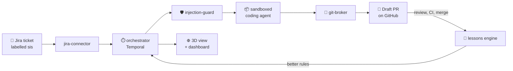

<div align="center">


# 🏭 SIS: the 3D Self-Improving Software Factory

### Enterprise-grade. Self-improving. Watch your software get built in 3D.

**Label a Jira ticket. Watch a robot pick it up on a 3D factory floor. Review the pull request.**

[](LICENSE)


[](#-contributing)

</div>

---

## 🚀 The promise

> **SIS is an Enterprise-grade 3D Self-Improving Software Factory that recursively improves itself.**
>
> 📅 **Exactly one year from now, on or before 1 November 2027, we will deliver a 100% locally runnable software factory:**
> no cloud, no outside API keys, no data leaving your machine.

Every ticket it works on, every review comment and every merged or rejected pull request becomes feedback. The factory turns that feedback
into rules, tests whether each rule really helps, keeps what works and drops what doesn't. It gets better at your codebase with every task.

---

## ✨ What it does

| | |
|---|---|
| 🎫 **Ticket to pull request** | Label a Jira ticket `sis`. A coding agent picks it up, changes the code and opens a **draft pull request** for people to review. |
| 🌐 **A live 3D factory floor** | Every task is a robot moving through the factory in real time (React Three Fiber). Click a robot to see its logs, answer its questions or stop it. |
| 🧠 **Self-improving** | Review feedback, CI failures and human fix-ups become candidate lessons. Each one is replayed on past tickets before it is adopted, then measured against a holdout group. Lessons that hurt are retired automatically. |
| 🔒 **Locked-down sandboxes** | Agents run in isolated containers (gVisor-ready) with no model keys and no direct network access. Everything goes through audited gateways. |
| 🛡️ **Prompt-injection defence** | Ticket text, comments and tool output are screened before they reach an agent. Everything published to GitHub is screened again on the way out. |
| 🏢 **Built for teams** | Multiple teams, per-team Jira and GitHub connections, encrypted secrets, sign-in, protected branches and production safety checks that refuse unsafe settings. |
| ⏱️ **Durable by design** | Built on Temporal: tasks survive restarts, crashes and redeploys, and every step is recorded. |
| 📊 **Dashboard** | A Next.js portal with every task, its full trail, workflows, teams, connections and lessons. |

---

## 🏗️ How it works



The loop on the right is what makes it self-improving: **signal → proposal → judged on past tickets → adopted → measured in use**.
More in [docs/self-improvement.md](docs/self-improvement.md).

---

## ⚡ Quick start

All you need on your machine is **Podman**, podman-compose, make, git and openssl. Everything else runs in containers.

```sh
git clone https://github.com/kuttybuski/sis-factory.git && cd sis-factory
cp .env.example .env
make init     # adds generated secrets and your Podman socket to .env
make up       # builds and starts the whole factory
```

| Open | Address |
|---|---|
| 📊 Dashboard | http://localhost:3000 |
| 🌐 3D view | http://localhost:5173 |
| 📘 API docs | http://localhost:8000/docs |

**Safe out of the box:** it starts with a demo agent that calls no model, in **dry run**, so nothing touches Jira, GitHub or a paid model
until you switch it on. Press **Demo** in the 3D view to see the factory in action right away.

Full setup for macOS, Linux and Windows (WSL 2): [docs/running.md](docs/running.md)

---

## 📚 Documentation

| Topic | Read |
|---|---|
| Installing and running | [docs/running.md](docs/running.md) |
| Teams, Jira and GitHub | [docs/teams.md](docs/teams.md), [docs/connections.md](docs/connections.md), [docs/configuration.md](docs/configuration.md) |
| How it learns | [docs/self-improvement.md](docs/self-improvement.md), [docs/context-and-learning.md](docs/context-and-learning.md), [docs/team-knowledge.md](docs/team-knowledge.md) |
| Reviews and handling rules | [docs/review-loop.md](docs/review-loop.md), [docs/handling.md](docs/handling.md) |
| Security and production | [docs/security.md](docs/security.md), [docs/threat-model.md](docs/threat-model.md) |
| Trying it on real work | [docs/pilot.md](docs/pilot.md) |
| What's next | [docs/roadmap.md](docs/roadmap.md) |
| Working on the code with an AI agent | [AGENTS.md](AGENTS.md) |

---

## 🧰 Built with

Python · FastAPI · Temporal · PostgreSQL · Next.js · React · React Three Fiber · Vite · Podman · gVisor · Helm

---

## 🤝 Contributing

Contributions are very welcome: bug reports, ideas, docs and code. Open an issue or a pull request.

```sh
make test         # Python and 3D view unit tests
make e2e          # the whole stack end to end against mock Jira and GitHub
```

---

## 📜 License

[**MIT**](LICENSE): use it, change it, sell it, ship it. The one condition is that copies keep the copyright and license
notice.

<div align="center">

**⭐ Star the repo to follow the road to a fully local, self-improving software factory by 1 November 2027.**

</div>
